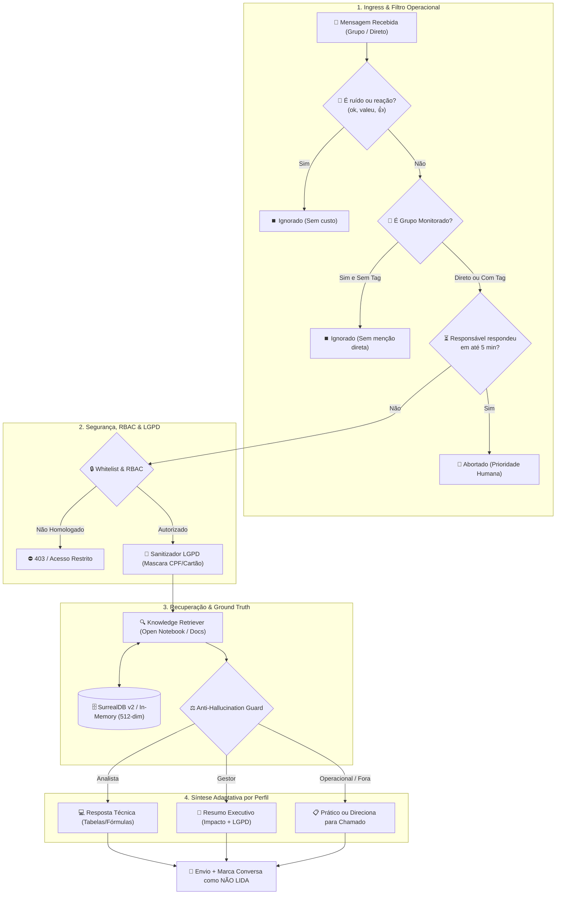

# Enterprise RAG Assistant Gateway 🛡️🤖

[](https://www.python.org/downloads/)
[](https://fastapi.tiangolo.com)
[](https://surrealdb.com)
[](https://www.docker.com)
[](#arquitetura-do-sistema)
[](#seguran%C3%A7a-e-conformidade-lgpd)
[](#testes-automatizados-e-smoke-test)

Gateway corporativo assíncrono de inteligência artificial com **Controle de Acesso Baseado em Papéis (RBAC Whitelist O(1))**, **Janela de Carência Human-in-the-Loop (5 minutos)**, **Banco Vetorial Semântico (SurrealDB v2 + Fallback em Memória)** e **Pipeline RAG com Respostas Adaptativas por Destinatário (Strict Ground Truth)**.

Projetado como uma **Arquitetura de Referência e Prova de Conceito (PoC)** para governança de atendimento corporativo via mensageria (ex: WhatsApp/Teams), garantindo que o assistente responda **exclusivamente a solicitações genuínas de contatos homologados**, adaptando o vocabulário (técnico para analistas, executivo para gestores e orientativo para colaboradores), sem jamais alucinar ou vazar dados confidenciais.

---

## 🎯 Regras Operacionais de Produção (Mundo Real)

Diferente de implementações ingênuas de chatbots que geram spam e conflito com o trabalho humano, esta arquitetura implementa 5 políticas operacionais estritas:

1. **Janela de Carência de 5 Minutos (Human-in-the-Loop Debounce):**
   - Ao receber uma solicitação relevante em grupos monitorados, o sistema aguarda uma janela de 5 minutos.
   - Se o responsável técnico responder manualmente dentro do prazo, **a automação é sumariamente abortada**, evitando duplicidade de respostas.
2. **Respostas Adaptativas por Perfil de Destinatário (Role-Based Personas):**
   - **Analistas Técnicos:** Respostas aprofundadas com nomes de tabelas, regras de negócio, fórmulas e consultas documentadas. Se a informação não existir, informa formalmente que o responsável retornará.
   - **Gestores e Liderança:** Linguagem executiva simples, foco no impacto do negócio, ausência de jargão técnico e aviso de conformidade com a LGPD.
   - **Demais Colaboradores (Operacional):** Explicações práticas e orientativas. Caso a documentação não responda, direciona formalmente para abertura de chamado no Service Desk corporativo.
3. **Filtro de Ruído & Grupos Monitorados:**
   - Em grupos técnicos, **apenas mensagens que mencionem/marquem diretamente o responsável** e façam uma pergunta genuína são processadas.
   - Mensagens de confirmação ("ok", "valeu", "combinado", reações 👍) são ignoradas sem acionar custos de LLM/inferência.
4. **Auditoria Humana Posterior (Mark as Unread):**
   - Toda resposta gerada automaticamente sinaliza o canal para **manter a conversa como não lida**, permitindo que o responsável audite a interação no seu fluxo de trabalho.
5. **Higienização de Infraestrutura & Rastreabilidade:**
   - Remove caminhos físicos locais da máquina do desenvolvedor (`D:\...`, `C:\...`), mas **preserva estritamente números de chamados (#2026...) e nomes de documentos** para garantir rastreabilidade regulatória.

---

## 🏗️ Arquitetura do Sistema



---

## 🚀 Tecnologias Utilizadas

| Componente | Tecnologia | Decisão de Engenharia |
| :--- | :--- | :--- |
| **Framework Web** | **FastAPI + Uvicorn** | Processamento assíncrono, tipagem estrita com Pydantic v2 e OpenAPI nativo. |
| **Banco Vetorial** | **SurrealDB v2** | Motor multi-modelo com suporte nativo a `vector::similarity::cosine`. |
| **Fallback Vetorial** | **NumPy Signed Hashing** | Implementação matemática de *Signed Feature Hashing* (512 dimensões) para execução 100% autônoma e testes offline. |
| **Gestão de Conhecimento** | **Open Notebook (SurrealDB)** | Base unificada consolidada e revisada periodicamente pelo responsável. |
| **Controle de Acesso** | **RBAC (Enum Roles)** | Segregação de papéis: `ANALYST`, `MANAGER`, `OPERATIONAL` e `UNAUTHORIZED`. |
| **Conformidade** | **Regex LGPD + Path Stripper** | Mascaramento de dados sensíveis e ocultação de diretórios internos. |
| **Containerização** | **Docker & Docker Compose** | Deploy idempotente em container Linux Python 3.11-slim. |

---

## 📂 Estrutura do Repositório

```text
enterprise-rag-assistant-gateway/
├── data/
│   └── samples/
│       └── sample_enterprise_knowledge.md  # Base documental sintética higienizada
├── scripts/
│   └── smoke_test.py                      # Teste de fumaça executável com 6 cenários operacionais
├── src/
│   ├── api/
│   │   ├── __init__.py
│   │   └── main.py                        # Rotas HTTP, Swagger e ciclo de vida
│   ├── core/
│   │   ├── __init__.py
│   │   ├── config.py                      # Pydantic Settings com fallback gracioso
│   │   └── security.py                    # RBAC Whitelist, Sanitizador LGPD e Expurgo de Paths
│   ├── gateway/
│   │   ├── __init__.py
│   │   └── webhook_handler.py             # Grace period de 5 min, filtro de ruído e menção
│   └── rag/
│       ├── __init__.py
│       ├── anti_hallucination.py          # Ground Truth e respostas adaptativas por perfil
│       ├── retriever.py                   # Ingestão de Markdown e busca semântica
│       └── vector_store.py                # Conector SurrealDB v2 + Signed Hashing em memória
├── tests/
│   ├── __init__.py
│   └── test_gateway.py                    # 13 testes automatizados com Pytest
├── .env.example                           # Configuração sanitizada
├── .gitignore                             # Regras de exclusão do Git
├── docker-compose.yml                     # Orquestração do SurrealDB v2 e API Gateway
├── Dockerfile                             # Containerização
├── README.md                              # Documentação de engenharia
└── requirements.txt                       # Dependências do projeto
```

---

## 🧪 Testes Automatizados e Smoke Test

### 1. Teste de Fumaça Executável (`scripts/smoke_test.py`)
Valida os 6 cenários críticos do fluxo operacional:
- [x] **Whitelist & RBAC:** Concessão correta de perfis (`ANALYST`, `MANAGER`, `OPERATIONAL`) e bloqueio de invasores.
- [x] **Higienização:** Mascaramento de CPFs/Cartões e expurgo de caminhos locais (`D:\...`) mantendo `#2026...`.
- [x] **Ingestão & Busca:** Segmentação automática de Markdown e busca vetorial indexada.
- [x] **Respostas por Perfil:** Validação do tom técnico para analista, tom executivo para gestor e escalonamento para chamado.
- [x] **Regras de Webhook:** Bloqueio por resposta manual nos 5 minutos (Grace Period), filtro de ruído e marcação como não lida.
- [x] **Latência de Resposta:** Tempo de processamento ponta a ponta inferior a 10ms.

Para executar:
```bash
python scripts/smoke_test.py
```

*Saída real dos testes:*
```text
==============================================================================
  ENTERPRISE RAG ASSISTANT GATEWAY :: SMOKE TEST SUITE (OPERAÇÃO REAL)
==============================================================================
[1/6] Validando Camada de Segurança (Whitelist & RBAC por Perfil)... [PASS]
[2/6] Validando Higienização LGPD e Expurgo de Caminhos Locais... [PASS]
[3/6] Validando Ingestão de Documentos e Busca Vetorial... [PASS]
[4/6] Validando Respostas Adaptativas por Perfil e Anti-Alucinação... [PASS]
[5/6] Validando Regras Reais do Webhook (Grace Period, Ruído, Auditoria)... [PASS]
[6/6] Validando Latência e Desempenho de Resposta... [PASS] (< 1ms)
==============================================================================
  TODOS OS 6 CENÁRIOS DO SMOKE TEST FORAM APROVADOS COM SUCESSO! (100% PASS)
==============================================================================
```

### 2. Suíte de Testes com Pytest
```bash
pytest tests/ -v
```

---

## 🛠️ Como Executar

### Com Docker Compose
```bash
docker compose up -d --build
```
Acesse a documentação interativa da API em: `http://localhost:8000/docs`

### Execução Local com Python
```bash
python -m venv .venv
source .venv/bin/activate  # No Windows: .venv\Scripts\activate
pip install -r requirements.txt
uvicorn src.api.main:app --host 0.0.0.0 --port 8000 --reload
```

---

## 🔒 Privacidade e Limites do Portfólio

Este repositório é uma **Prova de Conceito (PoC)** criada para demonstrar padrões arquiteturais de IA corporativa:
- Todos os exemplos utilizam exclusivamente **dados sintéticos**.
- Nenhuma conversa real, número de telefone, credencial ou identificador interno foi exposto.
- Não há dependência de infraestruturas fechadas ou ferramentas de terceiros não auditáveis.

---

## 👤 Autor

**Derlan Rodrigues**  
*Desenvolvedor Back-End & Engenheiro de Software*  
- GitHub: [@DerlanRodr](https://github.com/DerlanRodr)
